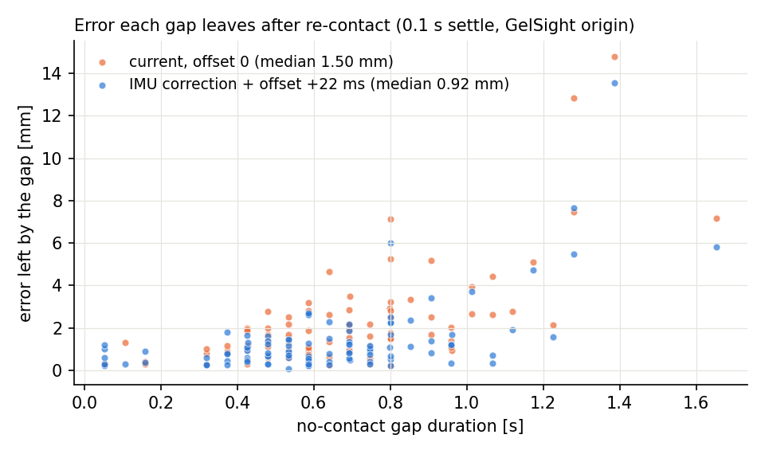
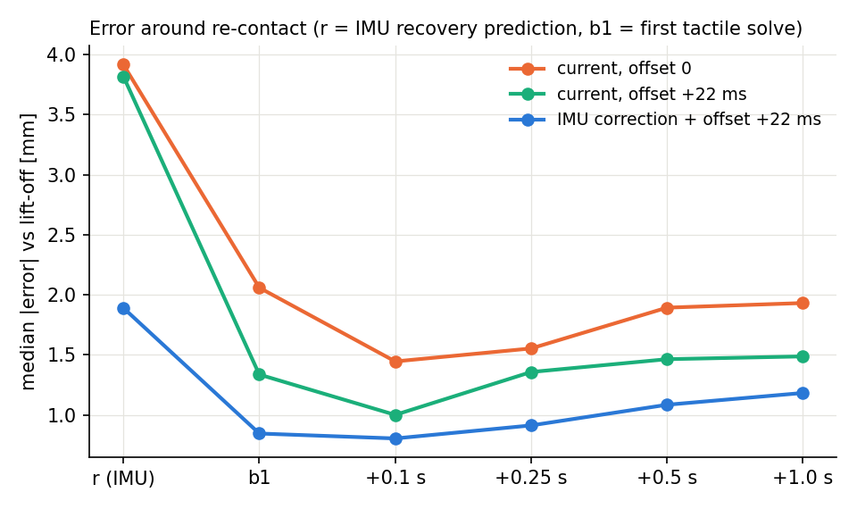

# Error after short no-contact gaps (2026-11-05)

## 요약 (한국어)

- 0.2 s 이상 떨어졌다가 다시 닿으면, tracker는 항상 IMU recovery keyframe을 만듭니다.
  떨어져 있는 동안의 위치는 IMU만으로 예측합니다(coast). 이 예측 오차가 약 3.9 mm입니다.
- 다시 닿은 뒤 첫 tactile solve가 이 오차의 약 80%를 되돌립니다(snap). 그래도 gap마다
  약 1.45 mm가 남고, frontend는 이것을 다시 고치지 않습니다. 그래서 짧게 떨어졌다가
  같은 곳으로 돌아와도 오차가 계단처럼 쌓입니다.
- coast 오차의 93%는 lift-off 순간 State의 일정한 가속도 오차(약 23 mm/s^2)입니다.
  주요 원인은 EBIMU 출력의 1 mg / 0.1 deg/s 양자화와 0 방향 truncation입니다.
  live IMU 데이터도 같습니다. 현재 작업 tree에서는 이 보정 기능이 지워져 있었습니다.
- source-clock bag에는 이미지-IMU 시간 차이 +22 ms가 남아 있습니다(회전 test로 측정).
  재접촉 snap은 이 시간 오차에 민감합니다.
- IMU 출력 보정 + offset +22 ms: 평균 RMSE 7.94 -> 4.36 mm, gap당 남는 오차
  1.45 -> 0.80 mm. 보정은 src/와 install/에 다시 적용했습니다.
- backend: IMU recovery keyframe에는 tactile 측정이 없어서, backend가 gap을 IMU factor만으로
  연결했습니다. 그래서 loop가 적은 trial에서 backend가 frontend보다 나빴습니다. recovery 연결에
  frontend 상대 pose를 odometry(1 mm)로 추가하고 backend IMU sigma를 0.003으로 바꿨습니다.
  keyframe RMSE 2.81 -> 2.51 mm.
- 효과가 없던 것: cross-gap tactile 정합(접촉 patch가 겹치지 않음), lift-off 속도/가속도
  seed, bias 평균, recovery 지연, reference 유지, noise 가중치 변경.
- live와 같은 ROS replay(12 trial, backend+feedback, 4회 반복 평균): 변경 전 3.03 mm ->
  변경 후 2.64 mm(-13%), raw bag offset -0.0395 적용 시 2.40 mm(-21%). 반복 간 표준편차도
  0.35 -> 0.09-0.15 mm로 줄었습니다.
- 재접촉 log에 gap 동안의 gyro 회전량을 출력합니다. 1 s 이상 또는 12 deg 이상인 gap이
  오차의 대부분을 만듭니다.

Question: the sensor lifts off, comes back after a short time (often to almost the
same place), and the error still increases. Why, and what removes it?

Data and method: the 12 real-objects trials
(`output/real_batch_20261030/bags_srcclock`, source-clock bags), frontend only.
`analysis/offline_run.py` runs `Tracker` on every image (deterministic, no backend).
Errors are against mocap GT. Mean position RMSE is the mean of the 12 per-trial
RMSE values of `eval_frontend.py` (IMU-origin pose, one SE(3) alignment at the first
state). Gap metrics use relative motion from the lift-off state, so they do not depend
on the alignment.

Labels used in this note:

- `a`: last accepted contact state before the gap (lift-off anchor).
- `r`: IMU recovery prediction at the first re-contact image (IMU-only coast from `a`).
- `b1`: first accepted tactile solve after `r`.
- `e(x)`: position error of `x` relative to `a` (estimated displacement minus GT).

## Result

1. Every re-contact after a gap of 0.2 s or more is an IMU recovery keyframe. The
   IMU-only coast from `a` to `r` has an error of 3.9 mm (median, gap median 0.6 s).
2. The first tactile solve `b1` moves the recovery state back by about the coast
   error (snap: `J = e(b1) - e(r)`, `J = -c e(r)` with `c = 1.0`, 76-86 % of the
   variance). A residual stays: 1.45 mm per gap (median, 0.1 s after `b1`). The
   frontend has no later correction, so each gap adds this residual permanently.
3. The coast error is almost all one constant acceleration offset in the lift-off
   state. With the tracker's own predictor (`coast_decomp.py`, same IMU samples,
   reproduces `r` to 0.0000 mm): removing one best constant world-acceleration offset
   leaves 0.25 mm of 3.35 mm; GT velocity at `a` leaves 3.21 mm. The offset is
   23 mm/s^2 (median; horizontal 18, vertical 10) and does not grow with trial time.
4. The EBIMU output is on a 1 mg / 0.1 deg/s grid and truncates toward zero (dataset
   bags and the live bag of 2026-11-04). The truncation correction removes most of
   the coast error. The current working tree no longer has `ImuOutputCorrection`.
5. The source-clock bags are not at image-to-IMU offset 0. The rotation method of
   `scripts/estimate_camera_imu_time_offset.py` gives +22.2 ms (trial_002) and
   +22.0 ms (trial_006), both qualified. The re-contact snap is sensitive to this
   offset, because the gel moves fast during the first contact frames.
6. With the IMU output correction and offset +22 ms together, mean RMSE goes from
   7.94 mm to 4.36 mm and the residual per gap from 1.45 mm to 0.80 mm.
7. The backend linked each gap by its IMU factor only (an IMU recovery keyframe has no
   tactile measurement, so no odometry). Where it found few loops it ended worse than
   the frontend. Odometry across the recovery link from the frontend seeds (1 mm) and a
   backend IMU sigma of 0.003 give keyframe RMSE 2.51 mm (was 2.81 mm).

## Changes in the working tree (2026-11-05, not committed)

| File | Change |
|---|---|
| `core/inertial.py`, `core/tracker.py` | `ImuOutputCorrection` restored (patch in `docs/patches/`). |
| `core/tracker.py` | Recontact log prints the gyro rotation over the gap (`_gap_rotation_deg`). |
| `core/loop_pose_graph.py` | New option `pose_graph_config.recovery_odometry_translation_sigma_m`. |
| `config/real_objects_config.yaml`, `config/live_thick_far_config.yaml` | Four IMU correction keys; `imu_integration_sigma_m: 0.003`; `recovery_odometry_translation_sigma_m: 0.001`. `real_objects_config.yaml` only: `image_to_imu_time_offset_s` -0.0615 -> -0.0395. |
| `test/test_inertial.py`, `test/test_recontact_gap_log.py`, `test/test_global_navigation_pgo.py`, `test/test_backend_navigation.py`, `test/test_static_imu_initialization.py`, `test/test_normal_correspondences.py`, `test/test_tactile_imu_audit.py` | Tests for the above; fixture fix (`gelsight_T_imu`); preset offset -0.0395; snapshot test on the current failure path; audit tests of removed features removed. |
| `install/` | Rebuilt (`colcon build --packages-select gelslam`). |

### Coast error after the correction and offset +22 ms (P2, 126 gaps)

| Quantity | Before (C0) | After (P2) |
|---|---|---|
| Coast error e0 at r (tracker predictor), median | 3.35 mm | 1.46 mm |
| Left after removing one constant acceleration offset | 0.25 mm | 0.20 mm |
| Constant offset, horizontal / vertical (with state velocity) | 19.7 / -7.4 mm/s^2 | 11.6 / -0.6 mm/s^2 |

The correction removes the vertical (bias / scale) part. A horizontal part of about
12 mm/s^2 (a tilt of about 0.07 deg) stays; it is the main coast error now. Lift-off
velocity or acceleration fits do not reduce it further (1.31-1.98 mm). It does not
follow the motion before lift-off (Spearman |rho| <= 0.21 with mean gyro rate, speed,
acceleration and rotation in the last 0.5 s, and with contact duration), so it is
treated as a slow IMU error, not as an operator or tracking effect.

## How to see the problem in a run

- Tracker log: each `Recontact after X s without contact (IMU rotation Y deg): skip
  cross-gap registration` is followed by `IMU Recovery Keyframe`. Every such event adds
  about 0.7-0.9 mm (median, with the correction) that the frontend never removes. X above
  about 1 s or Y above about 12 deg marks an expensive gap (table below). The rotation is
  the bias-corrected gyro angle over the gap (added 2026-11-05, log only).
- `tracker_process_summary.json`: `imu_recovery_keyframes` counts these events.
- `backend_process_summary.json`: `loop_pairs`. With few loops the backend cannot
  remove the gap errors (see Backend).
- Offline: `gap_timecourse.py` prints the error at `r`, `b1` and after; the residual
  0.1 s after `b1` is the per-gap cost.

## Which gaps are expensive (final setup P2, 100 gaps, GelSight origin, 0.1 s settle)

| Gap duration | n | Median (mm) | p90 (mm) |
|---|---|---|---|
| < 0.5 s | 32 | 0.68 | 1.37 |
| 0.5-0.8 s | 49 | 0.94 | 2.34 |
| 0.8-1.1 s | 12 | 1.23 | 3.34 |
| >= 1.1 s | 7 | 5.28 | 10.0 |

| Rotation during the gap | n | Median (mm) | p90 (mm) |
|---|---|---|---|
| < 5 deg | 41 | 0.69 | 1.58 |
| 5-12 deg | 29 | 0.85 | 1.48 |
| >= 12 deg | 30 | 2.18 | 5.85 |

The 10 largest gaps carry 39 % of the summed per-gap error. Gaps longer than about 1 s
or with more than about 12 deg of rotation without contact cause most of it.

## Main table (frontend only, 12 trials)

| Run | Code | IMU output correction | Offset | Mean RMSE (mm) | e(r) | e(b1) | Residual 0.1 s after b1 |
|---|---|---|---|---|---|---|---|
| C0 | current tree | off | 0 | 7.94 | 3.91 | 2.06 | 1.45 |
| F0 | current tree | off | +22 ms | 7.33 | 3.82 | 1.34 | 1.00 |
| H8 | HEAD | truncation only | 0 | 6.36 | 2.07 | 1.51 | 1.16 |
| H9 | HEAD | accel calibration only | 0 | 7.78 | 3.79 | 2.00 | 1.55 |
| H7 | HEAD | both | 0 | 5.80 | 2.04 | 1.55 | 1.14 |
| F1 | HEAD | both | +22 ms | 4.36 | 1.89 | 0.85 | 0.80 |

All runs use the current `real_objects_config.yaml` values (height 0.1, joint previous
state, `keep_imu_only_frames: false`, translation stop 1e-5). HEAD code with these
values gives the same numbers as the current tree (C0 = H6 trial by trial), so the
difference between rows is the IMU correction and the offset only.





## Time offset sweep (current tree, correction off)

| Offset (ms) | -61.5 | -20 | -10 | -5 | 0 | +5 | +10 | +15 | +20 | +30 | +40 |
|---|---|---|---|---|---|---|---|---|---|---|---|
| Mean RMSE (mm) | 21.3 | 10.98 | 9.13 | 8.54 | 7.94 | 7.61 | 7.29 | 6.98 | 7.17 | 7.26 | 6.88 |
| Residual per gap (mm) | - | 2.08 | 1.71 | 1.50 | 1.45 | 1.30 | 1.20 | 1.11 | 1.01 | 1.03 | 1.08 |

The RMSE minimum is flat from +15 to +40 ms (trial-to-trial noise); use the measured
+22 ms. A wrong sign is expensive: -61.5 ms (the raw-bag value) on these bags gives 21 mm.

## What did not help

| Test | Result |
|---|---|
| Cross-gap NormalFlow registration to the last pre-gap frame | The contact patch rarely overlaps: with the GT pose as initial value, 85 of 122 pairs fail (`shared_C < 10`). End to end (IMU start for the re-contact solve, all gaps): 7.81 vs 7.94 mm. |
| Lift-off velocity seed (`coast_velocity_fit`, inertial_quadratic) | Coast error 3.91 -> 3.19 mm, residual 1.45 -> 1.53 mm, RMSE 8.03 mm. |
| Lift-off velocity + acceleration seed (fit before lift-off, extrapolated) | Coast error -> 2.78-3.04 mm, residual 1.51-1.65 mm, RMSE 7.55-7.85 mm. The snap already removes most coast error; the residual does not follow the coast error. On the final setup (1.0 s window): 4.42 vs 4.34 mm, coast 1.93 vs 1.89 mm. |
| Accel bias averaged over the last 1 s / 3 s, or from the first contact | Coast error worse (3.87 / 6.25 / 15.3 vs 3.37 mm). |
| Delay the recovery keyframe to the 3rd / 5th contact image | RMSE 7.14 / 7.71 vs 7.29 mm (offset +10 ms), mixed per trial; residual worse. |
| Keep the recovery keyframe as the reference for 0.5 / 1.0 s (no low-SCR or timed keyframe) | RMSE 7.07 / 7.92 vs 7.29 mm (offset +10 ms); mixed per trial (trial_001 5.3 -> 3.1, trial_004 11.1 -> 15.0 at 1.0 s). On the final setup, 0.5 s: 4.28 vs 4.34 mm (within trial noise). |
| Noise model on the final setup (P2 4.34 mm) | imu weight 3e-4 4.73, 3e-5 4.27; bias weight 1e-3 5.43, 1e-5 4.77; accel noise 1e-3 4.49, 4e-3 4.98; accel bias walk 1e-3 5.08, 6e-3 4.79; integration sigma 1e-4 4.68, 1e-3 4.67; gyro noise 8e-5 4.82, 3e-4 4.30; gyro bias walk 7e-7 4.44, 7e-6 4.30 (rotation RMSE 0.81-0.83 deg in all). The current values are near the optimum; no noise setting reduces the remaining per-gap error (0.74-1.06 mm). |
| Constant lever-arm offset fit to the gap errors | 30 % in sample, fails cross-validation. |

## Backend (offline, keyframe poses)

`offline_backend_run.py` feeds the frontend keyframe packets to `TopicBackend`
(offset 0, correction off, deterministic). Keyframe RMSE with one SE(3) alignment at the
first keyframe:

| Loop search exclusion | Loops | Keyframe RMSE seed -> final (mm) |
|---|---|---|
| 10 most recent keyframes (current) | 4330 | 7.83 -> 3.38 |
| 3 most recent keyframes | 5079 | 7.83 -> 3.35 |

With the correction and offset +22 ms (`FB_C1`): keyframe RMSE 4.21 -> 2.81 mm.
Backend `imu_integration_sigma_m` 0.01 instead of 0.0003 (`FB_C2`): 4.21 -> 5.00 mm
(trial_005 16.6 mm, trial_006 10.7 mm). Without the recovery link below, a weaker
backend IMU breaks the gaps.
With backend feedback to the tracker (`offline_feedback_run.py`, zero latency, `FF0`):
frontend states are identical (4.34 mm) and the backend gives 2.79 mm. In the current
tree the feedback only changes publication and keyframe seed rebasing
(`Tracker.apply_map_snapshot` does not change the frontend state).

Why few loops hurt: the backend adds contact odometry only when the target keyframe has a
tactile measurement (`LoopPoseGraph.solve`, `tactile_valid`). An IMU recovery keyframe
has none, so a gap is linked by the backend IMU factor only, and the frontend's snapped
relative pose across the gap is not used. Test (overlay option
`recovery_odometry_translation_sigma_m`, odometry from the frontend seeds across the
recovery link): 1 mm gives 2.81 -> 2.64 mm (trial_005 6.0 -> 4.9, trial_006 6.8 -> 6.2;
loop-rich trials unchanged).

| Recovery odometry sigma | Backend IMU integration sigma | Keyframe RMSE (mm) | trial_005 | trial_006 | trial_003 |
|---|---|---|---|---|---|
| none (current) | 0.0003 | 2.81 | 6.0 | 6.8 | 1.6 |
| none | 0.01 | 5.00 | 16.6 | 10.7 | 1.6 |
| 3 mm | 0.0003 | 2.76 | 5.8 | 6.6 | 1.6 |
| 1 mm | 0.0003 | 2.64 | 4.9 | 6.2 | 1.6 |
| 0.3 mm | 0.0003 | 2.58 | 4.0 | 5.7 | 2.3 |
| 1 mm | 0.003 | 2.51 | 4.1 | 5.6 | 1.6 |
| 1 mm | 0.01 | 2.50 | 3.6 | 5.7 | 1.6 |
| frontend seeds | - | 4.20 | 4.1 | 5.0 | 7.1 |

With the recovery link, a weaker backend IMU no longer breaks the gaps and the
backend bends the trajectory less where it has no loops.

At offset 0 without the correction: the backend removes most gap error when it finds
loops (trial_003: 13.3 -> 1.6 mm, 447 loops). Trials with few loops do not improve
(trial_005: 5-6 loops, 7.7 -> 8.9 mm; trial_006: 10-11 loops, 10.4 -> 8.4 mm). The
recent-keyframe exclusion is not the limit: 3 instead of 10 adds 17 % loops and no
accuracy.

## Live-like ROS replay (12 trials, backend and feedback on)

`bag_replay_launch.py` with the raw bags (`timestamp_source: recorded_source`), real
time, backend and backend feedback on, final frame poses against GT (`run_real.sh` with
`backend_feedback:=true`). Real-time replay is not deterministic (about 0.5 mm per trial).

| Setup | Mean RMSE per run (mm) | 4-run mean +- sd (mm) | trial_005 per run | trial_006 per run |
|---|---|---|---|---|
| Before (no IMU correction, backend IMU 0.0003, no recovery odometry, offset -0.0615) | 2.91 / 2.71 / 3.54 / 2.96 | 3.03 +- 0.35 | 8.1 / 7.9 / 8.9 / 8.3 | 6.1 / 3.3 / 11.8 / 5.7 |
| After (correction, recovery odometry 1 mm, backend IMU 0.003, offset -0.0615) | 2.56 / 2.62 / 2.62 / 2.77 | 2.64 +- 0.09 | 5.8 / 5.1 / 6.1 / 8.0 | 5.0 / 5.3 / 4.8 / 4.9 |
| After, offset -0.0395 (= -0.0615 + 0.022) | 2.29 / 2.61 / 2.32 / 2.38 | 2.40 +- 0.15 | 4.8 / 6.0 / 4.6 / 6.5 | 3.7 / 6.1 / 4.0 / 3.8 |

The changes lower the mean (-13 %; -21 % with offset -0.0395, the shipped value) and
the run-to-run spread (sd 0.35 -> 0.09-0.15 mm; before, trial_006 once 11.8 mm).
Trials with few loops (005, 006) improve most.

`real_objects_config.yaml` now uses `image_to_imu_time_offset_s: -0.0395` for the raw
bags. The live config keeps its own rotation-test value.

## Live hardware check (not possible on 2026-11-05)

At 08:00 the GelSight camera was not on USB (no `/dev/video*`), and the EBIMU receiver
(`10c4:ea60`) delivered no IMU lines (`ebimu_publisher`: `device_clock mapped=0`), so the
sensor was probably off. The live path was checked only offline: the live config with
the IMU bag of 2026-11-04 (2000 of 2000 samples on the grid, no warning). To check live:
start `live_vi_launch.py`, do rest -> GO, lift off and re-contact several times, and read
the `Recontact after ... (IMU rotation ...)` lines and `loop_pairs`.

## Recommendations

1. IMU output correction: applied (see below). `src/` and `install/` were rebuilt on
   2026-11-05; `live_thick_far_config.yaml` has the four keys. Check with the live bag of
   2026-11-04: 2000 of 2000 samples are on the 1 mg / 0.1 deg/s grid, no off-grid warning.
2. Use `image_to_imu_time_offset_s: 0.022` for offline runs on the source-clock bags.
   Earlier offline tuning on these bags used 0 (22 ms error).
3. Live: keep the rotation-test offset (`-0.0668` on 2026-11-04) and repeat the test
   (`scripts/record_time_offset_calibration.sh`) after a camera or IMU setting change.
   An error of 10 ms adds about 1 mm RMSE and 0.3 mm per gap.
4. Backend: applied `pose_graph_config.recovery_odometry_translation_sigma_m: 0.001`
   (new option, `core/loop_pose_graph.py`) and `imu_integration_sigma_m: 0.003` in
   `real_objects_config.yaml` and `live_thick_far_config.yaml`. Offline keyframe RMSE
   2.81 -> 2.51 mm; trials with few loops are no longer much worse than the frontend.
   Still read `loop_pairs` in `backend_process_summary.json`: without loops the backend
   cannot remove the per-gap residual.

## Restoring the correction

Patch: `docs/patches/restore_imu_output_correction_20261105.patch`
(apply from the repository root with `patch -p1 < ...`). It restores HEAD
`ImuOutputCorrection` / `undo_truncation` in `core/inertial.py`, the three tracker
hooks (import, construction, `add_imu_sample`), the four `test_inertial.py` tests, and
adds the four keys to `real_objects_config.yaml` and `live_thick_far_config.yaml`:

```yaml
  output_truncation_gyro_step_rad_s: 0.0017453292519943296  # 0.1 deg/s
  output_truncation_accel_step_mps2: 0.00980665  # 0.001 g
  accel_calibration_bias_mps2: [0.010146590820458705, -0.018299274385377835, -0.07040754072005488]
  accel_calibration_scale: [-1.5244874151686127e-05, -0.003497099531017146, 0.0035123444051688322]
```

Validation on the current tree with the patch (frontend only, offset +22 ms):

| Run | initial_accel_bias_mps2 | Mean RMSE (mm) | Residual per gap (mm) |
|---|---|---|---|
| P1 | 0 (HEAD value) | 4.36 (identical to F1, trial by trial) | 0.80 |
| P2 | current config value | 4.34 | 0.79 |

Related tests with the patch: 211 passed (`test_inertial`, `test_tracker_inertial`,
`test_static_imu_initialization`, `test_contact_recovery_policy`,
`test_tracker_image_imu_sync`, `test_contact_velocity`).

Applied to `src/` on 2026-11-05. To undo, reverse the patch
(`patch -p1 -R < docs/patches/restore_imu_output_correction_20261105.patch`); later edits
in the same files (recontact log, backend option, config values) may need a manual merge.

Full suite after all changes (ament lint tests excluded): 731 passed, 0 failed.
Pre-existing failures that were resolved:
- `test_backend_navigation`: fixture without `gelsight_T_imu`; fixed.
- `test_normal_correspondences`: the snapshot test now uses the current failure path
  (the NormalFlow-only fallback was removed earlier in the working tree).
- `test_tactile_imu_audit`: 16 tests removed. They ran `scripts/audit_tactile_imu.py`
  against the removed pairwise frontend (`GtsamVisualInertialSolver.refine_current`) or
  checked the removed legacy no-contact `inertial_state` bias path. The 4 tests that
  still apply are kept. Restore with
  `git checkout -- src/gelslam/test/test_tactile_imu_audit.py` if the audit is ported.

## Reproduce

Scripts are in `scripts/real_objects_diagnostics/gap_analysis/` (run them from
`output/real_batch_20261030/analysis`, gel-slam conda Python, ROS sourced).
